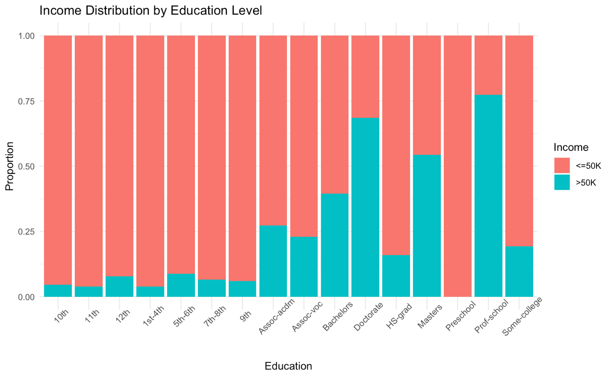
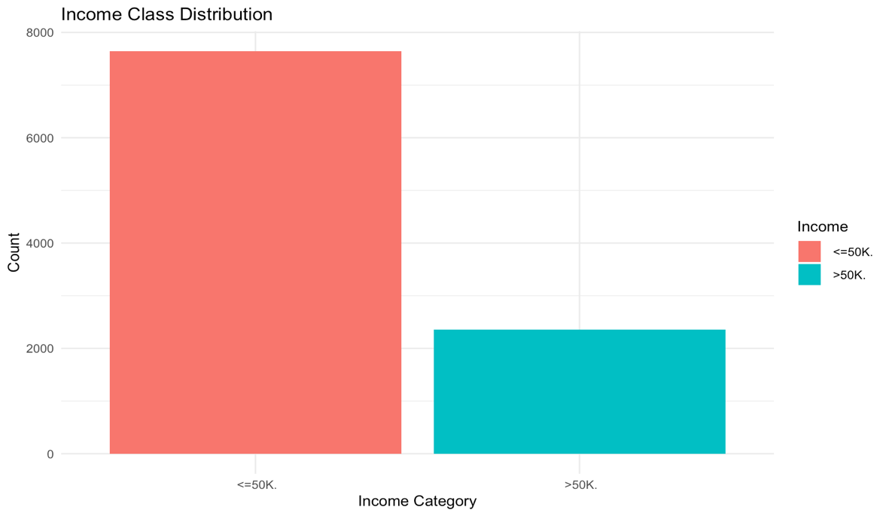
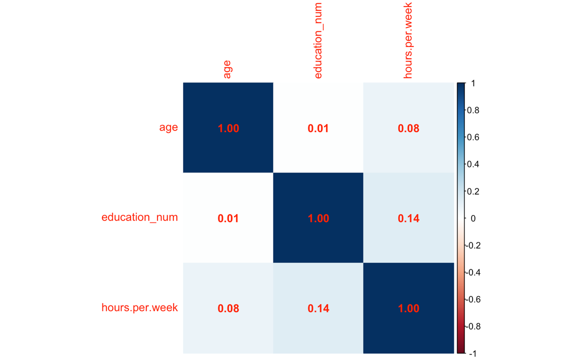
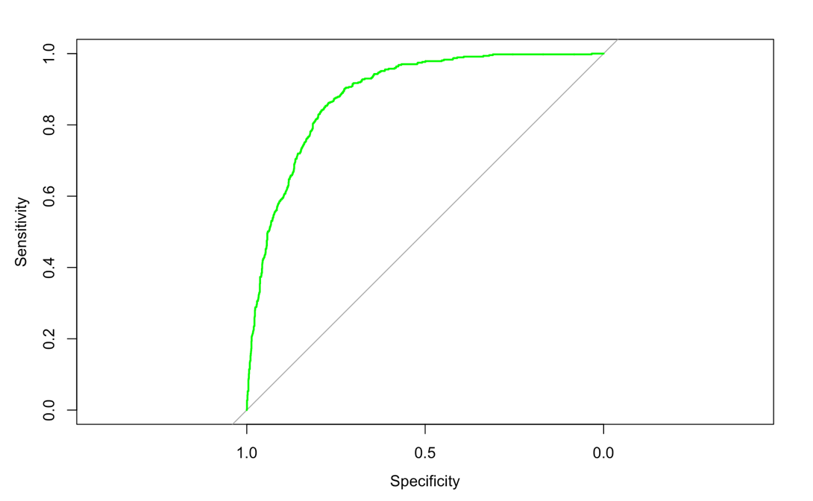
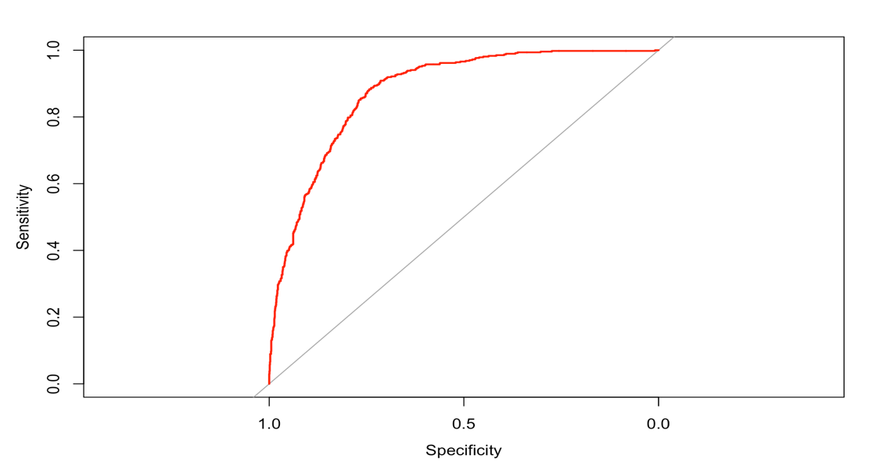
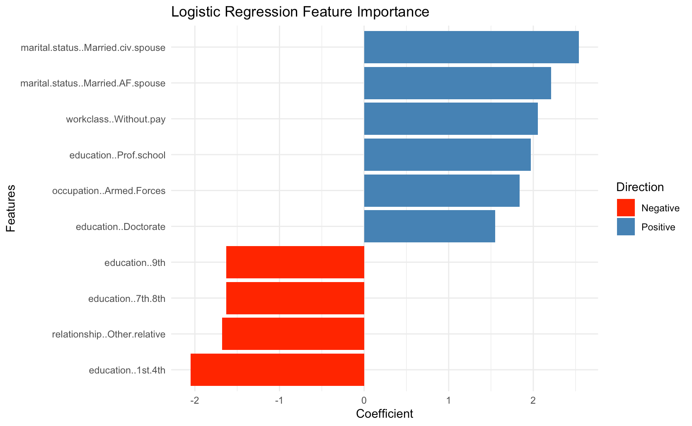
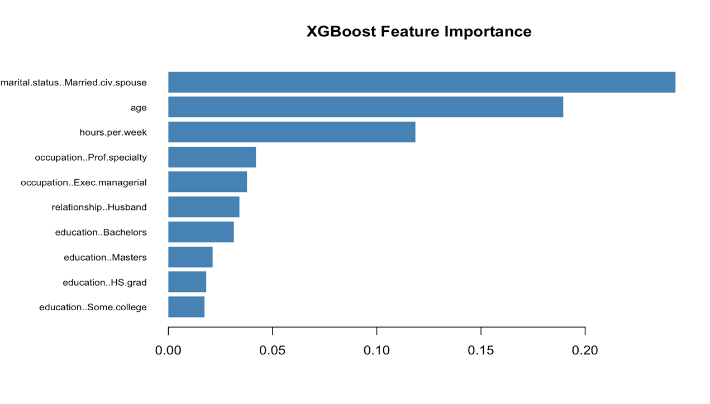

# 💰 Income Prediction with Machine Learning

Predicting whether an individual's annual income exceeds $50,000 using census data, comparing a simple, interpretable baseline (Logistic Regression) against a modern ensemble model (XGBoost) — and asking which one actually deserves the job.

Originally built for my MSc Data Science coursework at Northumbria University, restructured here as a standalone project.

## 📌 Overview

Income prediction models help researchers and policymakers understand the socioeconomic factors driving income inequality. This project uses the well-known **Census Income ("Adult") dataset** (10,000 observations, 11 features) to classify individuals into `<=50K` or `>50K` annual income brackets, using:

- **Logistic Regression** — the interpretable statistical baseline
- **XGBoost** — a high-capacity gradient-boosted ensemble model

The goal isn't just to get a working classifier — it's to compare the two honestly and draw a real conclusion about which approach fits this problem.

## 🎯 Objectives

- Explore the dataset and understand class balance and feature relationships
- Preprocess the data (missing values, encoding, train/test split) so it's model-ready
- Train and tune both a Logistic Regression and an XGBoost classifier
- Evaluate both with a full metric suite (not just accuracy, given class imbalance)
- Compare feature importance across both models to see whether they "think" the same way
- Draw a evidence-based conclusion on which model suits this problem

## 🔍 Exploratory Data Analysis

- 10,000 observations, 11 variables — mix of integer (age, education_num, hours-per-week) and categorical features
- **Class imbalance:** 76.4% of individuals earn `<=50K`, only 23.6% earn `>50K` — this shaped which metrics mattered later
- Missing values were hidden as the string `" ?"` rather than true `NA`s — `workclass` had 603 missing, `occupation` had 604
- Education level shows a clear relationship with income — Bachelors, Masters, Doctorate and Prof-school holders have a much higher share earning `>50K`
- The three numeric predictors (age, education_num, hours-per-week) are only weakly correlated with each other, so all three were safe to use together without multicollinearity concerns

| | |
|---|---|
|  |  |



## 🧹 Data Preprocessing

- `" ?"` values recoded to `NA`, then explicitly labelled as their own `"NA"` category (not dropped, to avoid unnecessary data loss)
- Categorical variables converted to factors, then **one-hot encoded** via `dummyVars()` so they're usable by both models
- **80:20 train/test split**, stratified on the target to preserve class balance
- For Logistic Regression specifically, `education_num` was dropped since it duplicates the information already in `education`, reducing multicollinearity

## 🧠 Models

**Logistic Regression** — trained with `glm()` using a binomial link; a 0.5 probability threshold separates the two income classes.

**XGBoost** — trained with:
- `max_depth = 7`, `eta = 0.1`, `nrounds = 250`
- `subsample = 0.8` and `colsample_bytree = 0.8` to reduce overfitting
- Binary logistic objective, AUC as the evaluation metric

## 📊 Results

| Metric | Logistic Regression | XGBoost |
|---|---|---|
| Accuracy | **83.5%** | 82.6% |
| Precision | 86.9% | **87.0%** |
| Recall | **92.3%** | 90.8% |
| F1-Score | **89.6%** | 88.9% |
| ROC-AUC | **0.886** | 0.879 |

| | |
|---|---|
|  |  |

**Logistic Regression edged out XGBoost on almost every metric** — a result that's actually more interesting than it sounds. It suggests the relationship between these socioeconomic variables and income is **mostly linear**, so the extra model capacity XGBoost offers isn't being put to good use here. XGBoost's main advantages — capturing complex non-linear interactions, handling high-dimensional data — simply aren't needed for this particular dataset.

| | Logistic Regression | XGBoost |
|---|---|---|
| Model type | Linear (statistical) | Ensemble (decision trees) |
| Complexity | Low / interpretable | High |
| Training speed | Near-instant | Moderate–high |
| Performance (this dataset) | Higher | Lower |
| Best use case | Linear relationships | Complex, non-linear patterns |

## 🔬 Feature Importance

Both models agree on the single most important predictor — **marital status (married, civilian spouse)** — but diverge after that:

- **Logistic Regression** leans heavily on specific **education levels**: Prof-school and Doctorate push income up strongly, while very low education levels (1st–4th, 7th–8th, 9th grade) push it down.
- **XGBoost** instead ranks **age** and **hours-per-week** highly — because tree-based models can pick up non-linear and threshold effects (e.g. income rising sharply after a certain age or hours worked) that a linear model can't represent as a single coefficient.

| | |
|---|---|
|  |  |

## ✅ Conclusion

Logistic Regression is the recommended model for this dataset — it's simpler, faster to train, more interpretable, and performed at least as well as XGBoost across every evaluation metric. The result reinforces a useful lesson: **a more complex model isn't automatically a better one** — model choice should follow from the structure of the data, not from reaching for the most sophisticated tool available.

## 🔍 Limitations & What I'd Improve

- **No hyperparameter search for XGBoost.** The XGBoost configuration (depth, learning rate, rounds) was set manually rather than tuned via grid/random search or Bayesian optimisation — it's possible a properly tuned XGBoost would close the gap with Logistic Regression, or even surpass it.
- **No cross-validation.** A single 80:20 split means the reported metrics carry some sampling variance. K-fold cross-validation would give more robust, less split-dependent estimates of both models' true performance.
- **Threshold fixed at 0.5.** Given the class imbalance, tuning the classification threshold (e.g. via the ROC curve's optimal point, or precision-recall trade-off) could improve recall on the minority `>50K` class specifically.
- **Fairness wasn't assessed.** Variables like sex and race were used as predictors without checking whether the models encode or amplify demographic bias — an important next step before using a model like this in any real policy context.
- **No feature engineering beyond one-hot encoding.** Interaction terms (e.g. education × occupation) or binning continuous variables (age groups) might reveal patterns neither model currently captures well.
- **Single dataset.** As the original report notes, testing both models on a different income dataset would help confirm whether "Logistic Regression wins here" generalises, or is specific to this data's structure.

## 🛠️ How to Reproduce

```r
install.packages(c("tidyverse", "caret", "pROC", "xgboost", "Matrix", "ggplot2", "corrplot"))
```

See `data/README.md` for where to get the dataset. Then:

```r
setwd("path/to/repo")
source("scripts/income_prediction_analysis.R")
```

## 🧠 Skills Demonstrated

`R programming` · `dplyr / tidyverse` · `ggplot2` · `data preprocessing (encoding, missing values)` · `logistic regression` · `XGBoost / gradient boosting` · `model evaluation (precision, recall, F1, ROC-AUC)` · `feature importance analysis` · `handling class imbalance` · `critical model comparison`

---

*Author: Mohammed Fadil — MSc Data Science, Northumbria University Newcastle*
# Income-Prediction-LR-vs-XGBoost-
